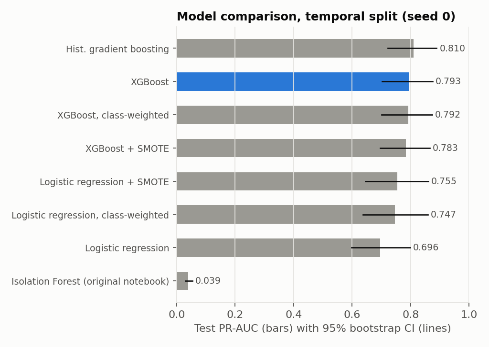
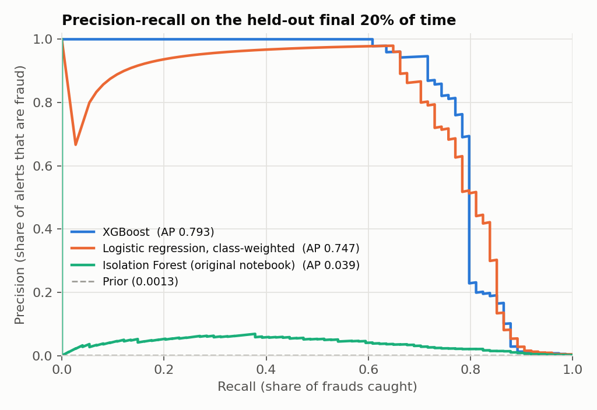
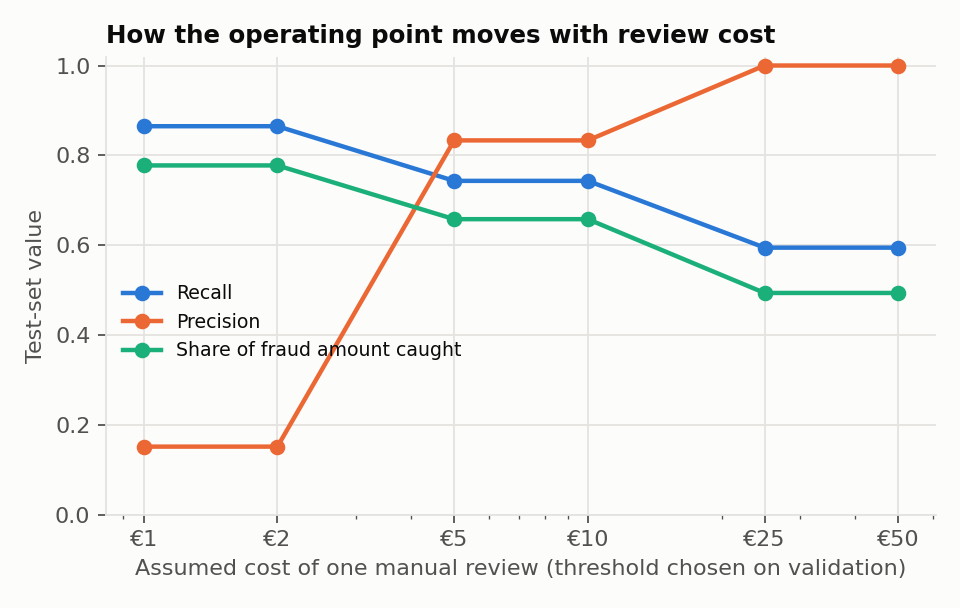

# Credit-Card Fraud Detection: a leakage-safe evaluation

[Results](results/RESULTS.md) · [Model card](docs/MODEL_CARD.md) · [Raw metrics](results/metrics.json)

This project evaluates fraud classifiers the way a deployment would face them: trained on
past transactions, with thresholds tuned on the next window, and scored on transactions that
come later in time. Every number below is produced by `python -m fraud.run_experiments` and
rendered into [`results/RESULTS.md`](results/RESULTS.md) by script. None are typed by hand.

## Why rebuild it

The original version of this repo (kept in [`legacy/`](legacy/)) was a single Colab notebook
with an Isolation Forest. It caught **44 of 136 frauds (recall 0.32)** on a random split and
reported 99.75% *accuracy*, a number that is meaningless at a 0.17% fraud rate. An older
copy of my portfolio site also showed XGBoost/SMOTE metrics that no code in this repo
produced. They have been removed. This rebuild replaces both with a reproducible pipeline.

## Main results

Test set = the last 20% of the two-day window (56,746 transactions, **74 frauds**). Model
selection and thresholds use the validation window only.



| Model | Test PR-AUC [95% CI] | Recall at val-chosen threshold | Precision |
|---|---|---|---|
| XGBoost (selected on validation) | **0.793** [0.702, 0.875] | 0.662 | 0.942 |
| Hist. gradient boosting | 0.810 [0.721, 0.889] | 0.676 | 0.943 |
| Logistic regression, class-weighted | 0.747 [0.637, 0.859] | 0.662 | 0.942 |
| Isolation Forest (original approach) | 0.039 [0.030, 0.054] | 0.149 | 0.049 |
| No-skill prior | 0.001 | — | — |

What the evidence supports:

- **Supervised models beat the original unsupervised approach by a wide margin.** XGBoost −
  Isolation Forest PR-AUC = +0.75 (paired bootstrap 95% CI +0.67 to +0.83). The Isolation
  Forest's ROC-AUC is 0.94 even though its PR-AUC is 0.04, which is why ROC-AUC alone is a
  poor headline metric for this problem.
- **Gradient boosting is not clearly better than a class-weighted logistic regression.**
  The difference is +0.040 PR-AUC, but the 95% CI (−0.017 to +0.114) includes zero. With
  74 test frauds, the evaluation can't separate the top models.
- **SMOTE didn't help gradient boosting** (XGBoost − XGBoost+SMOTE: +0.010, CI −0.017 to
  +0.040). For logistic regression, SMOTE and class weighting give similar gains over the
  unweighted model.
- **A random split flatters the model.** XGBoost scores 0.849 ± 0.026 PR-AUC on stratified
  random splits but 0.796 on the temporal split. Logistic regression barely moves (0.737
  vs 0.747). A random split would have overstated the boosted model's advantage.
- **Large frauds are the weak spot.** At the chosen threshold, the median missed fraud is
  €12.31 while the median caught fraud is €1.10. Only 1 of 4 frauds of €500 or more was
  caught. That's a small sample, but it's the right direction for future work, because missed
  amount is what costs money.

- **Over several time windows, boosting is steadier, not clearly stronger.** A rolling-origin
  check inside the development period ([`results/rolling_origin.json`](results/rolling_origin.json);
  3 out-of-time folds of 47–89 frauds each; the final test window is untouched) gives XGBoost
  PR-AUC 0.748 ± 0.049 against 0.726 ± 0.141 for class-weighted logistic regression. XGBoost wins
  2 of 3 folds. The linear model swings from 0.57 to 0.84 between windows.



### Choosing an operating point

A fixed probability threshold isn't a business decision. `threshold_min_cost` picks the
threshold on validation that minimises *missed fraud amount + review cost × alerts*. The
review cost is an **assumption** (default €5 per manual review), so the
[sensitivity table](results/RESULTS.md#review-cost-sensitivity-xgboost) shows how
precision, recall and the share of fraud value caught move as it changes.



### Calibration

XGBoost's raw scores are already well calibrated on this data: Brier 0.00042, and isotonic
recalibration fit on validation doesn't improve it (0.00044). Isotonic also turns scores into
steps and lowers ranking quality (PR-AUC 0.793 → 0.748), so the deployed scores stay
uncalibrated.

## Scoring API

`python -m fraud.export_model --data creditcard.csv` refits the selected model and **refuses to
write it unless its test PR-AUC equals the published value** (0.7929). That makes `model/model.json`
provably the evaluated model. `model/model_card.json` records the threshold, test metrics and SHA-256 hashes.

```bash
uvicorn fraud.serve:app --app-dir src          # http://localhost:8000/docs
curl -X POST localhost:8000/score -H 'content-type: application/json'      -d '{"transactions":[{"V":[0.1,0.1,0.1,0.1,0.1,0.1,0.1,0.1,0.1,0.1,0.1,0.1,0.1,0.1,0.1,0.1,0.1,0.1,0.1,0.1,0.1,0.1,0.1,0.1,0.1,0.1,0.1,0.1],"Amount":12.5}]}'
```

Input is validated: exactly 28 finite `V` values, `0 ≤ Amount ≤ 1,000,000`, and at most 1,000
transactions per request. Invalid input returns 422 without echoing values. Measured on a laptop
CPU (Intel i5-12450H, local uvicorn, 300 requests): one transaction p50 2.7 ms / p95 3.7 ms; a
batch of 1,000 takes 32 ms. `Dockerfile` and `render.yaml` are included. **There is no public
deployment yet**, so no live URL is claimed.

## Method

| Step | Choice | Why |
|---|---|---|
| Data integrity | SHA-256 checked against the public release. 1,081 exact duplicate rows dropped **before** splitting. | Duplicates across splits leak labels |
| Split | Chronological 60/20/20 on `Time`. Stratified random splits run only as a robustness check. | A deployed model only sees future transactions |
| Preprocessing | Scaling and SMOTE live **inside** the model pipeline, fit on train only. A unit test asserts this. | Prevents test-set leakage |
| Model selection | Highest **validation** PR-AUC | Test set touched once |
| Metrics | PR-AUC (primary), ROC-AUC, precision/recall at a validation-chosen threshold, Brier, ECE | Accuracy is uninformative at 0.17% prevalence |
| Uncertainty | 1,000 stratified bootstrap resamples of the test set; paired differences; 5 training seeds | 74 test frauds means wide intervals |
| Features | `V1`–`V28` (PCA components released by the data owner) and `Amount`. `Time` is used only for splitting. | Elapsed seconds since the first transaction doesn't generalise |

## Reproduce

```bash
pip install -r requirements-dev.txt
# download creditcard.csv from https://www.kaggle.com/datasets/mlg-ulb/creditcardfraud
PYTHONPATH=src python -m fraud.run_experiments --data path/to/creditcard.csv   # ~6 min on a laptop CPU
PYTHONPATH=src python -m fraud.make_report
PYTHONPATH=src python -m fraud.rolling_origin --data path/to/creditcard.csv  # ~2 min
PYTHONPATH=src pytest -q tests                                                 # synthetic data, no download
```

The run writes `results/metrics.json`, `results/RESULTS.md` and `figures/*.png`. Running it
twice with the same seeds gives identical model metrics.

## Limitations

- **Two days of data, 473 frauds in total.** The test set holds 74 frauds, so intervals
  are wide and small differences between models aren't meaningful.
- **Anonymised features.** `V1`–`V28` are PCA components released by the data owner, so
  there's no feature engineering or domain interpretation. The top features by gain (V14,
  V10, V17) can't be explained in business terms.
- **The cost model is stylised.** Real fraud operations have chargeback rules, partial
  recoveries and customer-friction costs that aren't modelled here.
- **No concept-drift study.** Two days is too short to measure how quickly the model
  degrades over time.
- **Hyperparameters are fixed, sensible defaults, not tuned.** Tuning on 57 validation frauds
  would mostly fit noise.

## Data

Machine Learning Group, Université Libre de Bruxelles (ULB), distributed on Kaggle as
"Credit Card Fraud Detection". The data isn't redistributed in this repository; see the
dataset page for its licence. The release is associated with Dal Pozzolo, Caelen, Johnson
and Bontempi, *Calibrating Probability with Undersampling for Unbalanced Classification*,
IEEE Symposium Series on Computational Intelligence (SSCI), 2015.

## Layout

```
src/fraud/data.py            load, validate, de-duplicate, temporal / stratified splits
src/fraud/models.py          model zoo (prior, Isolation Forest, LR variants, HistGB, XGBoost variants)
src/fraud/evaluate.py        metrics, threshold selection, bootstrap, calibration error
src/fraud/run_experiments.py full protocol -> results/metrics.json + figures
src/fraud/make_report.py     results/metrics.json -> results/RESULTS.md
src/fraud/rolling_origin.py  out-of-time folds inside the development window
src/fraud/export_model.py    refit + verify + export the served model
src/fraud/serve.py           FastAPI scoring service
model/                       exported model and model card
tests/                       27 tests on synthetic data (run in CI)
legacy/                      the original notebook, report and slides
```
